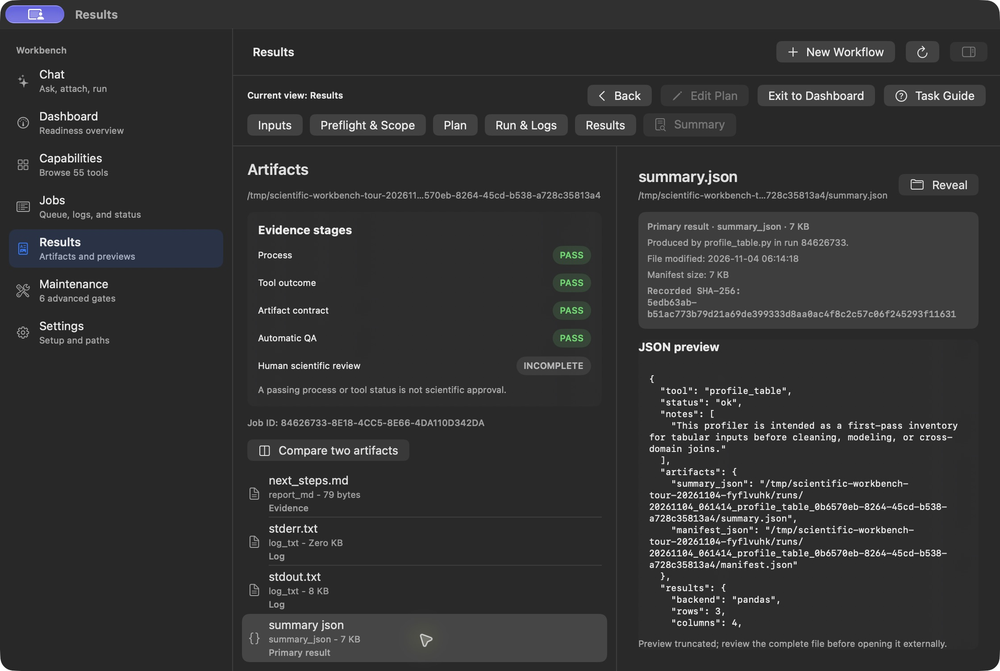
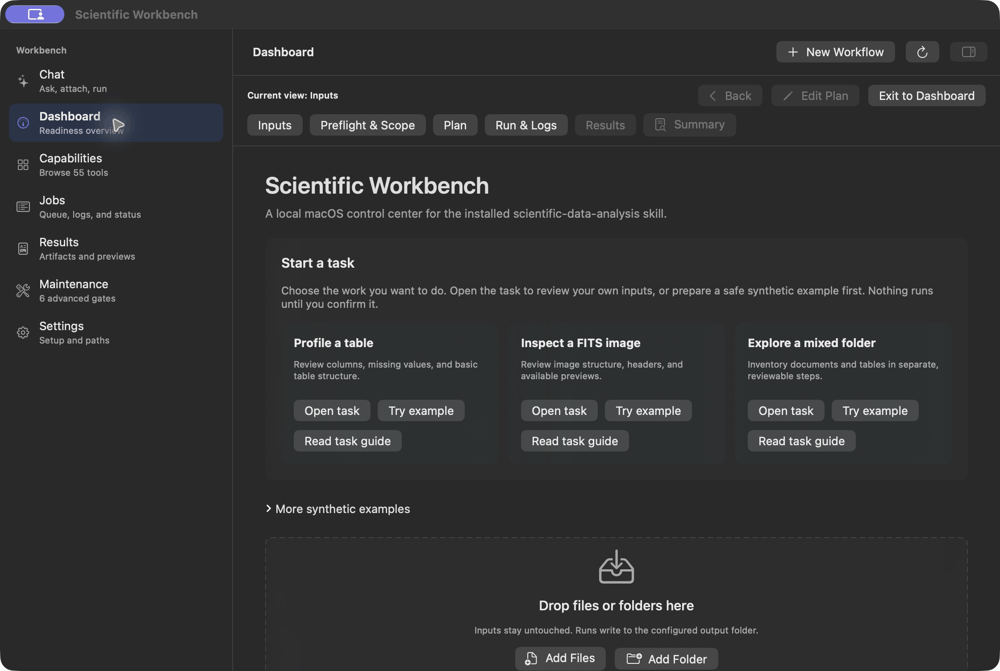
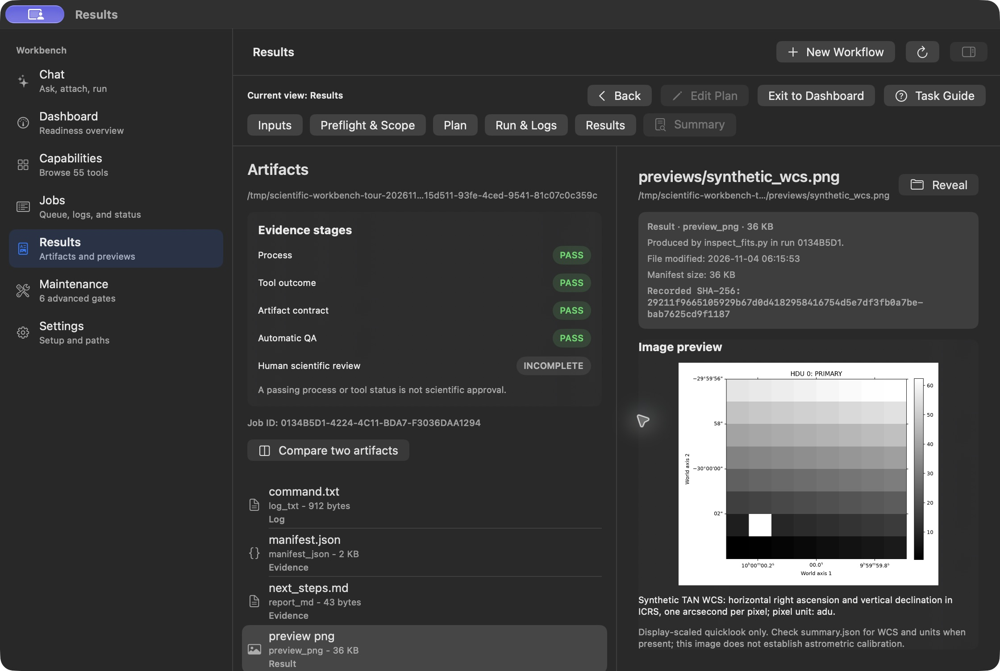
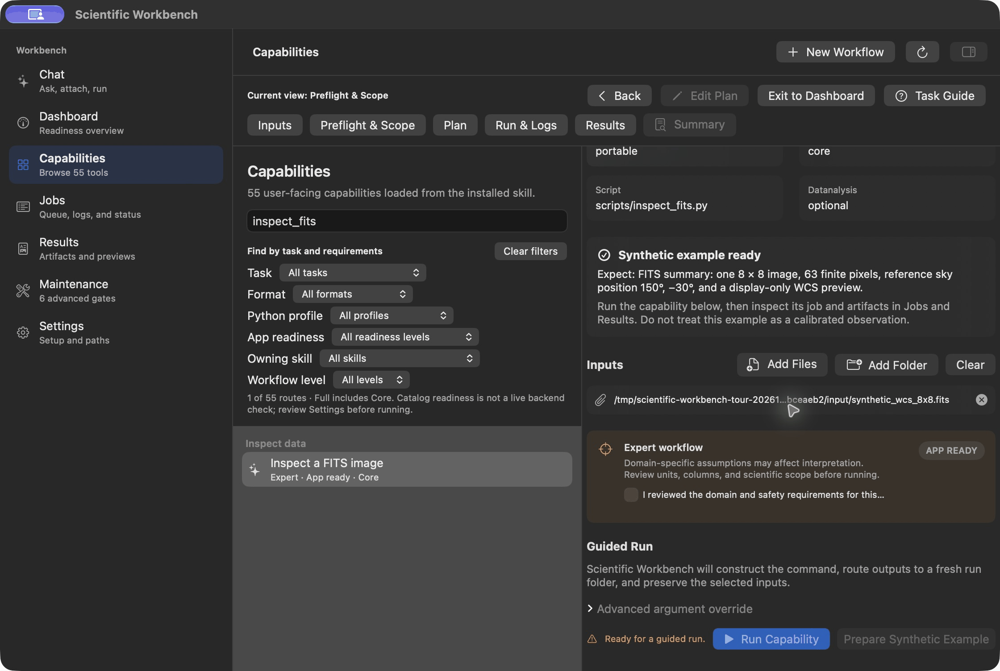
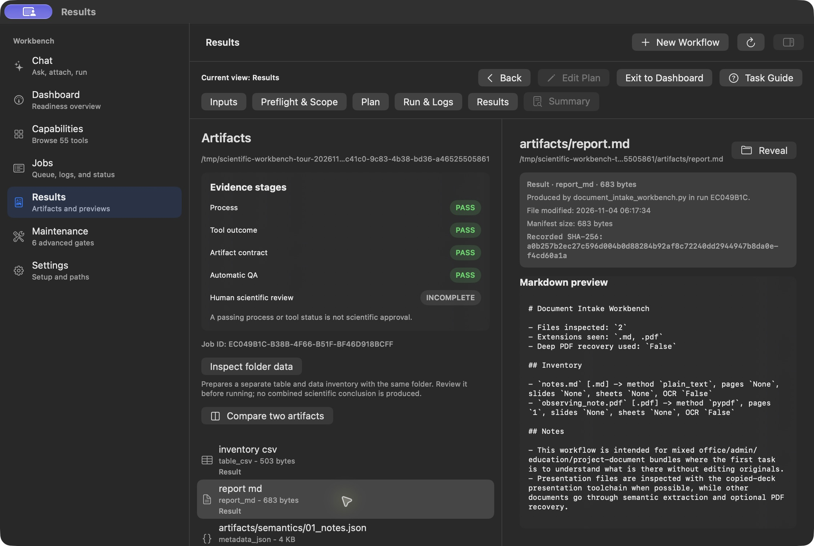
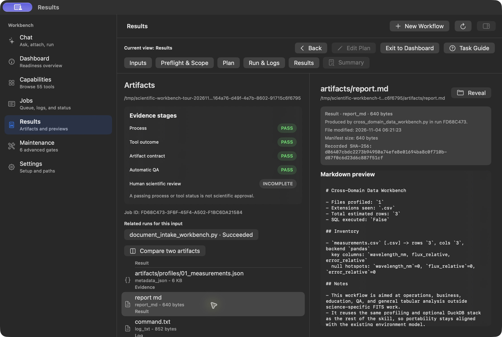
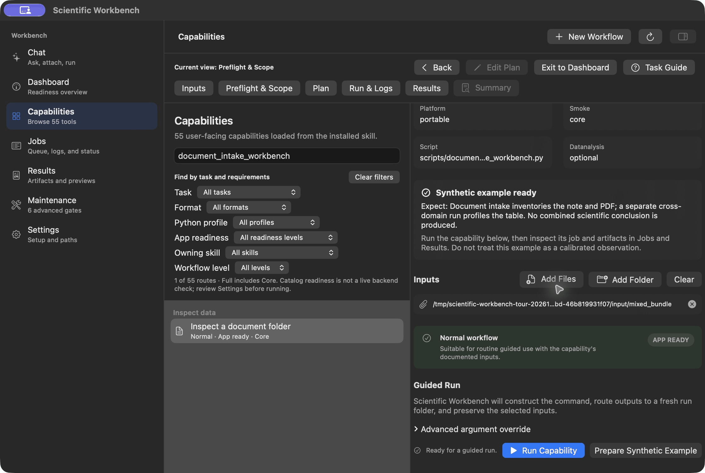
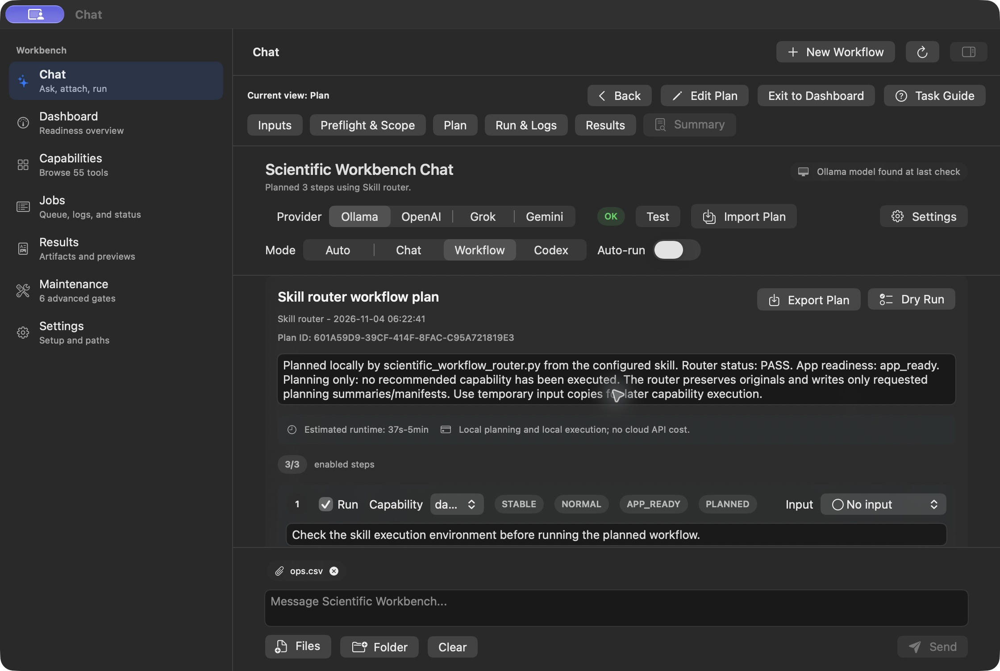

# First workflow tours

These are real Scientific Workbench screens from source commit `ce38859`,
captured on 2026-11-04. They show three synthetic examples: a table, a FITS
image, and a mixed folder. Each animation is a sequence of selected screens,
held for 3.5 seconds per frame. It is not a continuous recording or a runtime
benchmark. The written steps and static results below provide the same route
without animation.

Build and configure the app using [INSTALL.md](../INSTALL.md), including the
bundled skills, an existing Core Python environment, and a separate output
folder. The demonstrated jobs need no model, cloud account, or optional
external program. Core still needs its documented Python packages. This
record reused an existing Core environment; it does not demonstrate a fresh
installation. See the [setup matrix](CAPABILITY_SETUP_MATRIX.md) for other tasks.

On **Dashboard**, **Try example** prepares a fresh synthetic input and selects
its capability. Review the input and output destination before **Run Capability**:
that direct action starts a job immediately. Each generated example retains
its `expected.json`, input hashes, and origin notes. A retry should write to a
new run folder. These examples contain no real observations.

## Profile a table

1. Choose the small table's **Try example** action on Dashboard.
2. Review **Profile a CSV table**, its selected `ops.csv`, and Core requirements.
3. Choose **Run Capability**, then inspect **Run & Logs** and **Open Results**.
4. Select `summary.json`: the example has **3 rows and 4 columns**. Inspect
   `manifest.json` for the retained input and output evidence.

The final screen separates process, tool, artifact, and automatic QA findings
from human scientific review. Profiling does not validate a scientific method
or justify changing the original data.

Play the table tour: Dashboard, review, job, and result

Use the [short table guide](../Guides/Workflow_Table.md) for cancellation,
context-preserving navigation, a CLI equivalent, and the separate spectrum example.

## Inspect a FITS image

1. Choose the FITS example's **Try example** action.
2. Review **Inspect a FITS image**, its input, and the Expert access notice.
   **Run Capability** remains disabled until you explicitly confirm access.
3. After reviewing the scope, confirm and run. The selected progress screen
   records a real running job, not an estimated internal tool percentage.
4. Open Results, inspect the WCS preview, and read `summary.json` and
   `manifest.json` alongside it.

The generated primary image is **8 × 8**, with **63 finite pixels**, an `adu`
header unit, and reference sky position **RA 150° / Dec −30°**. The scale is
one arcsecond per pixel. The PNG is a display-only quicklook of this exact
synthetic fixture. A header and coordinate overlay do not establish
astrometric calibration; other FITS inputs retain the documented metadata-only
guided default.

Play the FITS tour: review, confirmation, running job, preview, and metadata

Read the [short FITS guide](../Guides/Workflow_FITS.md) for input limits,
expected values, and a CLI equivalent.

## Inspect a mixed research folder

1. Choose the mixed folder's **Try example** action. It creates `notes.md`,
   a one-page `observing_note.pdf`, and `measurements.csv`.
2. Review and run **Inspect a document folder** (`document_intake_workbench`).
   In Results, select `report.md` and check the **two documents** and their
   extraction methods. This job does not profile the CSV.
3. Choose **Inspect folder data**. This only prepares
   `cross_domain_data_workbench` with the same input folder; it starts no job.
4. Review that second capability and choose **Run Capability**. Its report
   inventories **one CSV, 3 rows, and 3 columns**. SQL was not executed in this
   example. **Related runs for this input** links back to the document job.

Play the mixed-folder tour: two reviewed jobs and their separate results

Keep both run folders. The inventories do not create a combined scientific
conclusion. Review extraction, units, dates, and joins before interpreting real
material. The [short mixed-folder guide](../Guides/Workflow_Mixed_Folder.md)
includes both CLI commands and the one-page PDF variant.

## Review a Chat plan before executing it

Direct capability jobs above are separate from a multi-step Chat workflow.
In Chat, leave **Auto-run** off, attach the input, and request a workflow.
Review enabled steps, permissions, dependencies, network use, and output
destinations. **Dry Run** validates planned commands; **Run Enabled** executes
the reviewed plan. **Summary** then connects its Workflow Run ID with steps,
jobs, logs, and artifacts. A direct capability job instead has a Job ID and
tool summary.

The screen below is a real, deterministic **Skill router** plan for the table.
No recommended step was executed. **Edit Plan** reveals the current plan, and
**Task Guide** opens the bundled table guide even when a diagnostic is the
first step. Its rationale was translated into English in the actual editor
before capture; this does not demonstrate English output from an AI provider.

**Back**, **Edit Plan**, and **Exit to Dashboard** preserve workflow context.
Leaving a view does not cancel work. Use **Cancel Run** in Chat or Jobs to
stop an active owned process; keep its partial output and logs. Use
**New Workflow** to archive the current draft before starting another task.
Read [troubleshooting](TROUBLESHOOTING.md) before retrying an error.

## What this evidence establishes

Four real GUI jobs completed against a copy of the five bundled skills:
`profile_table`, `inspect_fits`, `document_intake_workbench`, and
`cross_domain_data_workbench`. Their process exit codes were zero, summaries
reported `app_status: PASS` and `original_modified: false`, and every output
listed in their manifests matched its recorded size and SHA-256. All five
generated input files still matched `expected.json`. These are internal
technical checks; human scientific review remains incomplete.

The build used Apple Swift 6.4, the available macOS 26.5 SDK, and the SwiftPM
native build system with the repository's CLT test fallback on the maintainer's
macOS 27.0.1 Apple Silicon Mac. The default Swift Build path previously failed
before compilation on that toolchain; the workaround does not establish that
the default path works. The current source passed 378/378 Swift tests locally. This
record establishes neither independent usability nor manual operation on
another Mac, and does not demonstrate optional backends, a model download,
cloud planning, or a fresh installation.

The test bundle was signed ad hoc for local use. It is not a signed or
notarized downloadable release. Check [Actions for the exact source you use](https://github.com/interemi/scientific-workbench-public/actions/workflows/portable-validation.yml);
local captures do not establish hosted CI success for this source commit.

[Media provenance](media/workflows/provenance.json) records the full source
commit, binary hash, capture times, synthetic input hashes, Job IDs, verified
manifest outputs, and final media hashes. PNG stills preserve the decoded
capture pixels. GIFs use 256-color quantization with no resizing, cropping,
overlays, or repainted UI. Only synthetic examples are shown; private raw
accessibility trees, launch configuration, logs, and runtime archives remain
outside Git. macOS screen-sharing decoration is retained in the captures.
